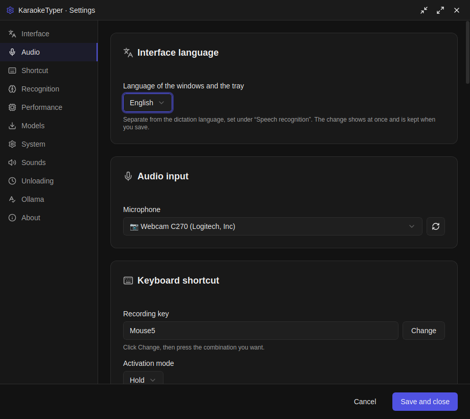
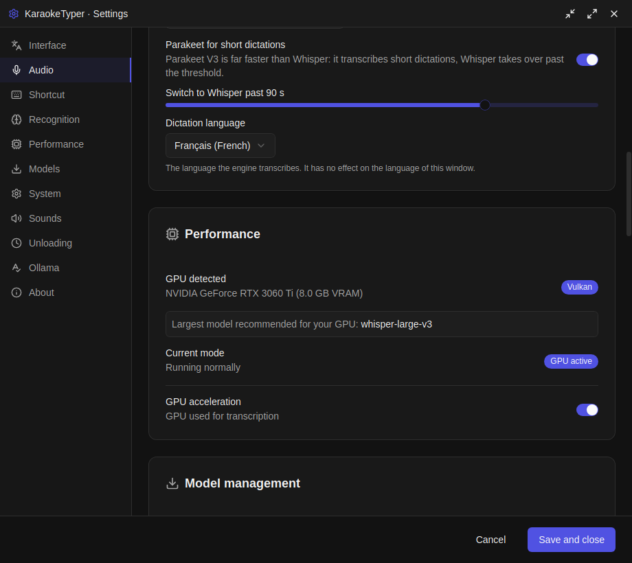
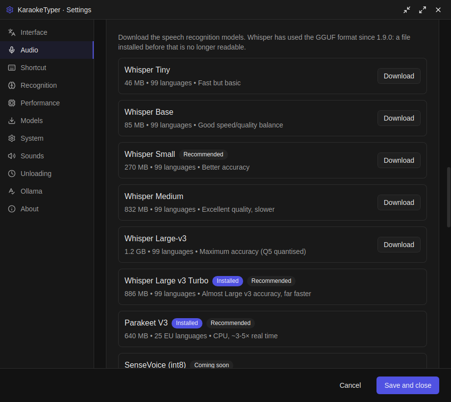
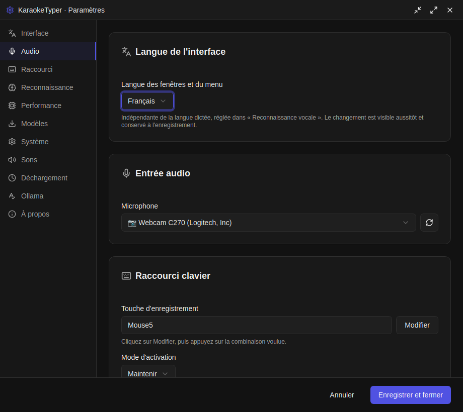

<p align="center">
  
</p>

<h1 align="center">KaraokeTyper</h1>

<p align="center">
  <strong>Offline voice dictation with push-to-talk</strong><br>
  <strong>Dictée vocale hors-ligne avec push-to-talk</strong>
</p>

<p align="center">
  <a href="#english">English</a> •
  <a href="#français">Français</a>
</p>

<p align="center">
  <a href="https://github.com/Sebdev43/KaraokeTyper/releases/latest"></a>
  <a href="LICENSE"></a>
  
  
  
</p>

<p align="center">
  
  
</p>

<p align="center">
  
</p>

---

# English

## Overview

**KaraokeTyper** is a privacy-first, cross-platform voice dictation application. All speech recognition happens **100% offline** — Whisper, or NVIDIA Parakeet when you want speed. No cloud, no telemetry, no data leaving your machine.

Press `Ctrl+Space` (or Mouse5), speak, release - your words appear instantly in any application.

## Features

| Feature | Description |
|---------|-------------|
| **Push-to-Talk** | Hold `Ctrl+Space` or Mouse5 to record, release to transcribe |
| **100% Offline** | All AI processing happens locally on your machine |
| **Cross-Platform** | Native support for Linux, Windows, and macOS |
| **Privacy-First** | Zero telemetry, zero cloud, zero data collection |
| **On-Demand Mic** | Microphone only active during recording (no system tray mic icon) |
| **Fast Transcription** | Native ggml inference delivers high-accuracy results in seconds |
| **Auto-Type** | Text automatically injected into focused application |
| **Multi-Language** | Support for French, English, German, Spanish, and 95+ languages |
| **Bilingual Interface** | The app itself reads in English or French, switched live in Settings → Interface |
| **Multiple Models** | Whisper Tiny/Base/Small/Medium/Large-v3 for quality/speed trade-offs |
| **Gaming Mouse Support** | Configure Mouse4, Mouse5, or any mouse button as hotkey |
| **Modern UI** | Clean dark theme with real-time status indicators |
| **System Tray** | Runs quietly in the background |

## Interface language

The interface ships in **English and French**. Pick one under **Settings →
Interface**: the three windows, the tray menu and the messages the backend
writes (downloads, updates, permissions) all switch immediately, with no
restart. On a first launch the app follows the system locale (`LANG`), and the
stored setting decides from then on.

This is a separate setting from the **dictation language** under *Speech
recognition*, which is what the model transcribes — dictating in French from an
English interface is a normal combination, not a mistake.

Adding a third language is two files: a catalogue under `src/i18n/` typed
against `fr.ts` (TypeScript refuses a missing key), and one arm per message in
`src-tauri/src/i18n.rs`.

## Platform support

All three desktop targets are built and published, and dictation works on each
of them. They are not equal, though, and you should know which half you get.
**Linux is where KaraokeTyper is designed and used daily**; the rest gets the
portable features.

| | Linux | Windows | macOS |
|---|---|---|---|
| Capture, transcription, models | yes | yes | yes |
| GPU acceleration | Vulkan | Vulkan | Metal |
| Keyboard push-to-talk | yes (evdev) | yes | yes |
| **Mouse-button push-to-talk** | **yes** | no | no |
| Typing into the focused app | xdotool / wtype / uinput | enigo | enigo |
| Terminal detection (GNOME extension) | yes | — | — |
| Packages | `.deb`, `.rpm`, `.AppImage` | `.msi`, `.exe` | `.dmg` (Apple Silicon) |

The one difference you will actually notice: a shortcut bound to a mouse button
only fires on Linux, where the app reads input events directly. Everywhere else,
use a keyboard shortcut.

## Upgrading to 1.9.0

Whisper models moved to the GGUF format, and the file installed by an earlier
version can no longer be read. Open **Settings → Models** and download yours
again — it is two to three times smaller than before. The old file is left
untouched on disk; the application tells you where it is and how big it is, so
you can remove it yourself.

Nothing else to do: settings, shortcuts and custom words are kept.

## Screenshots

Everything is a setting you can read: which engine is loaded, which model is
installed, how much VRAM it wants, what the GPU is actually doing. No screen
promises a result it cannot show.

| Speech recognition and GPU | Model management |
|---|---|
|  |  |

A recording overlay — a small dark pill with a level meter — appears near the
cursor while you hold the shortcut, and fades out when the text is typed.

## Installation

### Download

Download the latest release for your platform:
- **Linux**: `.deb` or `.AppImage`
- **Windows**: `.msi` or `.exe`
- **macOS**: `.dmg`

👉 [Download Latest Release](https://github.com/Sebdev43/KaraokeTyper/releases/latest)

### Install on Linux

**Debian/Ubuntu (.deb):**
```bash
# Install
sudo dpkg -i karaoketyper_*_amd64.deb
sudo apt-get install -f  # Fix dependencies if needed

# Launch
karaoketyper
```

**AppImage:**
```bash
# Make executable and run
chmod +x KaraokeTyper_*_amd64.AppImage
./KaraokeTyper_*_amd64.AppImage
```

### Install on Windows

**Installer (.exe):**
1. Double-click `karaoketyper_*_x64-setup.exe`
2. Follow the installation wizard
3. Launch from Start Menu

**MSI Package:**
```powershell
# Or via command line
msiexec /i karaoketyper_*_x64_en-US.msi
```

### Install on macOS

1. Open `karaoketyper_*_aarch64.dmg` — **Apple Silicon only**, macOS 11 or later. No Intel build is published.
2. Drag **KaraokeTyper** to the **Applications** folder
3. On first launch: Right-click → Open (to bypass Gatekeeper)

## Uninstallation

### Uninstall on Linux

**Debian/Ubuntu:**
```bash
sudo apt remove karaoketyper
# Or completely remove with config:
sudo apt purge karaoketyper
```

**AppImage:**
```bash
# Simply delete the file
rm KaraokeTyper_*.AppImage
# Remove user data (optional):
rm -rf ~/.config/karaoketyper
rm -rf ~/.local/share/karaoketyper
```

### Uninstall on Windows

1. Open **Settings** → **Apps** → **Installed Apps**
2. Find **KaraokeTyper** and click **Uninstall**

Or via Control Panel → Programs → Uninstall a program

**Remove user data (optional):**
```powershell
Remove-Item -Recurse "$env:APPDATA\karaoketyper"
```

### Uninstall on macOS

1. Drag **KaraokeTyper** from Applications to Trash
2. Empty Trash

**Remove user data (optional):**
```bash
rm -rf ~/Library/Application\ Support/karaoketyper
rm -rf ~/Library/Preferences/com.karaoketyper.app.plist
```

### Build from Source

#### Prerequisites

- **Node.js** 18+ and npm
- **Rust** stable (the CI builds with the current stable toolchain)
- **Linux, GPU build only** (`--features gpu-vulkan`): the Whisper engine builds
  ggml's Vulkan backend from source, which needs the Vulkan loader, the shader
  compiler and the SPIR-V headers:

  ```bash
  sudo apt install libvulkan-dev glslc spirv-headers
  ```

  A plain `cargo build` is CPU-only and needs none of them.

```bash
# Clone the repository
git clone https://github.com/Sebdev43/KaraokeTyper.git
cd KaraokeTyper

# Install dependencies
npm install

# Run in development mode
npm run tauri dev
```

### First Launch

1. Open the **Settings** window (F10 or system tray)
2. Select your preferred Whisper model (Tiny for speed, Large-v3 for accuracy)
3. Download the model (automatic via Settings)
4. Select your microphone
5. Ready to dictate!

## Usage

### Basic Workflow

1. **Focus** any text field (browser, editor, terminal...)
2. **Hold** `Ctrl+Space` (or Mouse5) and speak clearly
3. **Release** to transcribe and auto-type

### Hotkeys

| Shortcut | Action |
|----------|--------|
| `Ctrl+Space` | Push-to-talk (hold to record) |
| `Mouse5` | Alternative push-to-talk (configurable) |
| `F10` | Open settings window |

### Status Indicators

| Color | State |
|-------|-------|
| 🟢 Green | Ready - waiting for input |
| 🔴 Red | Recording - speak now |
| 🟠 Orange | Processing - transcribing audio |

## Available Models

| Model | Size | Speed | Accuracy | Best For |
|-------|------|-------|----------|----------|
| **Whisper Tiny** | 46 MB | Fastest | Good | Quick notes, low-resource devices |
| **Whisper Base** | 85 MB | Fast | Better | Light dictation |
| **Whisper Small** | 270 MB | Medium | Very Good | Daily dictation (recommended) |
| **Whisper Medium** | 832 MB | Slower | Excellent | High accuracy needs |
| **Whisper Large v3 Turbo** | 886 MB | Fast | Excellent | Nearly Large v3, far quicker |
| **Whisper Large-v3** | 1.16 GB | Slowest | Best | Maximum accuracy |
| **Parakeet TDT 0.6B v3** | 640 MB | Fastest | Very Good | 25 European languages, auto-detected |

Models ship as GGUF. Sizes are the actual download, already quantised — Large v3
was 3.1 GB before version 1.9.0.

## Building

```bash
# Development
npm run tauri dev

# Production
npm run tauri build
```

**Output formats:**
- **Linux**: AppImage, .deb
- **Windows**: .msi, .exe
- **macOS**: .dmg, .app

## Privacy & Security

- All speech recognition runs **locally** on your hardware
- **No internet connection** required for core functionality
- **No telemetry**, analytics, or tracking of any kind
- **No cloud services** - your voice data never leaves your machine
- Audio is processed in memory and **never saved** to disk
- Microphone only active when PTT key is held
- Open source - audit the code yourself

## License

This project is licensed under the **MIT License** - see the [LICENSE](LICENSE) file for details.

**You CAN**: Use, modify, and share for personal/non-commercial purposes.
**You CANNOT**: Use commercially or sell without explicit permission.

<p align="center">
  
</p>

---

# Français

## Présentation

**KaraokeTyper** est une application de dictée vocale multi-plateforme axée sur la confidentialité. Toute la reconnaissance vocale se fait **100% hors-ligne** — Whisper, ou NVIDIA Parakeet quand vous voulez de la vitesse. Pas de cloud, pas de télémétrie, aucune donnée ne quitte votre machine.

Appuyez sur `Ctrl+Espace` (ou Mouse5), parlez, relâchez - vos mots apparaissent instantanément dans n'importe quelle application.

## Fonctionnalités

| Fonctionnalité | Description |
|----------------|-------------|
| **Push-to-Talk** | Maintenez `Ctrl+Espace` ou Mouse5 pour enregistrer, relâchez pour transcrire |
| **100% Hors-ligne** | Tout le traitement IA se fait localement sur votre machine |
| **Multi-plateforme** | Support natif pour Linux, Windows et macOS |
| **Confidentialité** | Zéro télémétrie, zéro cloud, zéro collecte de données |
| **Micro à la demande** | Microphone actif uniquement pendant l'enregistrement (pas d'icône micro dans la barre système) |
| **Transcription rapide** | L'inférence ggml native offre des résultats de haute précision en quelques secondes |
| **Frappe automatique** | Le texte est automatiquement injecté dans l'application active |
| **Multi-langue** | Support du français, anglais, allemand, espagnol et 95+ langues |
| **Interface bilingue** | L'application elle-même s'affiche en français ou en anglais, changée à chaud dans Paramètres → Interface |
| **Plusieurs modèles** | Whisper Tiny/Base/Small/Medium/Large-v3 pour différents compromis qualité/vitesse |
| **Support souris gaming** | Configurez Mouse4, Mouse5 ou n'importe quel bouton comme raccourci |
| **Interface moderne** | Thème sombre avec indicateurs de statut en temps réel |
| **Barre système** | Fonctionne discrètement en arrière-plan |

## Langue de l'interface

L'interface existe en **français et en anglais**. Le choix se fait dans
**Paramètres → Interface** : les trois fenêtres, le menu de la barre système et
les messages écrits par le moteur (téléchargements, mises à jour, permissions)
basculent immédiatement, sans redémarrage. Au premier lancement, l'application
suit la langue du système (`LANG`) ; ensuite, c'est le réglage qui décide.

C'est un réglage distinct de la **langue dictée**, sous *Reconnaissance
vocale*, qui est celle que le modèle transcrit — dicter en français depuis une
interface anglaise est une combinaison normale, pas une erreur.

Ajouter une troisième langue tient en deux fichiers : un catalogue dans
`src/i18n/` typé d'après `fr.ts` (TypeScript refuse une clé manquante), et une
branche par message dans `src-tauri/src/i18n.rs`.

## Prise en charge des plateformes

Les trois systèmes sont construits et publiés, et la dictée fonctionne sur
chacun. Ils ne sont pas équivalents pour autant, et autant que vous le sachiez
avant d'installer. **Linux est l'environnement de conception et d'usage
quotidien** ; les deux autres reçoivent les fonctions portables.

| | Linux | Windows | macOS |
|---|---|---|---|
| Capture, transcription, modèles | oui | oui | oui |
| Accélération GPU | Vulkan | Vulkan | Metal |
| Push-to-talk clavier | oui (evdev) | oui | oui |
| **Push-to-talk bouton de souris** | **oui** | non | non |
| Frappe dans l'application active | xdotool / wtype / uinput | enigo | enigo |
| Détection des terminaux (extension GNOME) | oui | — | — |
| Paquets | `.deb`, `.rpm`, `.AppImage` | `.msi`, `.exe` | `.dmg` (Apple Silicon) |

La seule différence que vous rencontrerez vraiment : un raccourci assigné à un
bouton de souris ne déclenche que sous Linux, où l'application lit directement
les événements d'entrée. Ailleurs, utilisez un raccourci clavier.

## Mise à jour vers la 1.9.0

Les modèles Whisper sont passés au format GGUF, et le fichier installé par une
version précédente n'est plus lisible. Ouvrez **Paramètres → Modèles** et
retéléchargez le vôtre : il est deux à trois fois plus léger qu'avant. L'ancien
fichier reste intact sur votre disque ; l'application vous indique où il est et
ce qu'il pèse, à vous de le supprimer.

Rien d'autre à faire : réglages, raccourcis et mots personnalisés sont conservés.

## Captures

Tout ce qui est à l'écran est un réglage qu'on peut lire : quel moteur est
chargé, quel modèle est installé, la VRAM qu'il réclame, ce que fait réellement
le GPU. Aucun écran ne promet un résultat qu'il ne sait pas montrer.

| Reconnaissance vocale et GPU | Gestion des modèles |
|---|---|
|  |  |

Pendant que le raccourci est maintenu, un overlay d'enregistrement — une petite
pastille sombre avec un indicateur de niveau — apparaît près du curseur, puis
s'efface une fois le texte tapé.

## Installation

### Téléchargement

Téléchargez la dernière version pour votre plateforme :
- **Linux** : `.deb` ou `.AppImage`
- **Windows** : `.msi` ou `.exe`
- **macOS** : `.dmg`

👉 [Télécharger la dernière version](https://github.com/Sebdev43/KaraokeTyper/releases/latest)

### Installer sur Linux

**Debian/Ubuntu (.deb) :**
```bash
# Installer
sudo dpkg -i karaoketyper_*_amd64.deb
sudo apt-get install -f  # Corriger les dépendances si nécessaire

# Lancer
karaoketyper
```

**AppImage :**
```bash
# Rendre exécutable et lancer
chmod +x KaraokeTyper_*_amd64.AppImage
./KaraokeTyper_*_amd64.AppImage
```

### Installer sur Windows

**Installateur (.exe) :**
1. Double-cliquez sur `karaoketyper_*_x64-setup.exe`
2. Suivez l'assistant d'installation
3. Lancez depuis le menu Démarrer

**Package MSI :**
```powershell
# Ou via ligne de commande
msiexec /i karaoketyper_*_x64_en-US.msi
```

### Installer sur macOS

1. Ouvrez `karaoketyper_*_aarch64.dmg` — **Apple Silicon uniquement**, macOS 11 ou plus récent. Aucune version Intel n'est publiée.
2. Glissez **KaraokeTyper** vers le dossier **Applications**
3. Au premier lancement : Clic droit → Ouvrir (pour contourner Gatekeeper)

## Désinstallation

### Désinstaller sur Linux

**Debian/Ubuntu :**
```bash
sudo apt remove karaoketyper
# Ou supprimer complètement avec la config :
sudo apt purge karaoketyper
```

**AppImage :**
```bash
# Supprimez simplement le fichier
rm KaraokeTyper_*.AppImage
# Supprimer les données utilisateur (optionnel) :
rm -rf ~/.config/karaoketyper
rm -rf ~/.local/share/karaoketyper
```

### Désinstaller sur Windows

1. Ouvrez **Paramètres** → **Applications** → **Applications installées**
2. Trouvez **KaraokeTyper** et cliquez sur **Désinstaller**

Ou via Panneau de configuration → Programmes → Désinstaller un programme

**Supprimer les données utilisateur (optionnel) :**
```powershell
Remove-Item -Recurse "$env:APPDATA\karaoketyper"
```

### Désinstaller sur macOS

1. Glissez **KaraokeTyper** depuis Applications vers la Corbeille
2. Videz la Corbeille

**Supprimer les données utilisateur (optionnel) :**
```bash
rm -rf ~/Library/Application\ Support/karaoketyper
rm -rf ~/Library/Preferences/com.karaoketyper.app.plist
```

### Compiler depuis les sources

#### Prérequis

- **Node.js** 18+ et npm
- **Rust** stable (la CI compile avec la *stable* du moment)

```bash
# Cloner le dépôt
git clone https://github.com/Sebdev43/KaraokeTyper.git
cd KaraokeTyper

# Installer les dépendances
npm install

# Lancer en mode développement
npm run tauri dev
```

### Premier lancement

1. Ouvrez la fenêtre **Paramètres** (F10 ou barre système)
2. Sélectionnez votre modèle Whisper préféré (Tiny pour la vitesse, Large-v3 pour la précision)
3. Téléchargez le modèle (automatique via Paramètres)
4. Sélectionnez votre microphone
5. Prêt à dicter !

## Utilisation

### Workflow de base

1. **Focalisez** n'importe quel champ texte (navigateur, éditeur, terminal...)
2. **Maintenez** `Ctrl+Espace` (ou Mouse5) et parlez clairement
3. **Relâchez** pour transcrire et taper automatiquement

### Raccourcis clavier

| Raccourci | Action |
|-----------|--------|
| `Ctrl+Espace` | Push-to-talk (maintenir pour enregistrer) |
| `Mouse5` | Push-to-talk alternatif (configurable) |
| `F10` | Ouvrir les paramètres |

### Indicateurs de statut

| Couleur | État |
|---------|------|
| 🟢 Vert | Prêt - en attente |
| 🔴 Rouge | Enregistrement - parlez maintenant |
| 🟠 Orange | Traitement - transcription en cours |

## Modèles disponibles

| Modèle | Taille | Vitesse | Précision | Idéal pour |
|--------|--------|---------|-----------|------------|
| **Whisper Tiny** | 46 Mo | Plus rapide | Bonne | Notes rapides, appareils peu puissants |
| **Whisper Base** | 85 Mo | Rapide | Meilleure | Dictée légère |
| **Whisper Small** | 270 Mo | Moyenne | Très bonne | Dictée quotidienne (recommandé) |
| **Whisper Medium** | 832 Mo | Lente | Excellente | Haute précision |
| **Whisper Large v3 Turbo** | 886 Mo | Rapide | Excellente | Presque Large v3, bien plus vite |
| **Whisper Large-v3** | 1,16 Go | Plus lente | Meilleure | Précision maximale |
| **Parakeet TDT 0.6B v3** | 640 Mo | Plus rapide | Très bonne | 25 langues européennes, détectées seules |

Les modèles sont au format GGUF. Les tailles sont celles du téléchargement réel,
déjà quantifié — Large v3 pesait 3,1 Go avant la version 1.9.0.

## Compilation

```bash
# Développement
npm run tauri dev

# Production
npm run tauri build
```

**Formats de sortie :**
- **Linux** : AppImage, .deb
- **Windows** : .msi, .exe
- **macOS** : .dmg, .app

## Confidentialité et sécurité

- Toute la reconnaissance vocale s'exécute **localement** sur votre machine
- **Aucune connexion internet** requise pour les fonctionnalités principales
- **Aucune télémétrie**, analytique ou suivi
- **Aucun service cloud** - vos données vocales ne quittent jamais votre machine
- L'audio est traité en mémoire et **jamais sauvegardé** sur le disque
- Microphone actif uniquement quand la touche PTT est maintenue
- Open source - auditez le code vous-même

## Licence

Ce projet est sous licence **MIT** - voir le fichier [LICENSE](LICENSE) pour plus de détails.

**Vous POUVEZ** : Utiliser, modifier et partager pour usage personnel/non-commercial.
**Vous NE POUVEZ PAS** : Utiliser commercialement ou vendre sans autorisation explicite.

---

## Architecture

```
KaraokeTyper/
├── src/                    # Frontend React/TypeScript
│   ├── components/         # UI components (shadcn/ui)
│   ├── stores/             # State management (Zustand)
│   └── bindings.ts         # Tauri TypeScript bindings
├── src-tauri/              # Backend Rust
│   ├── src/
│   │   ├── lib.rs               # Tauri commands & setup
│   │   ├── audio.rs             # Audio capture (CPAL cross-platform)
│   │   ├── vad.rs               # Silero voice activity detection
│   │   ├── stt/                 # Engine dispatch, hybrid routing, runtime
│   │   ├── catalog/             # Versioned, hash-pinned model catalogue
│   │   ├── model_downloader.rs  # Model download manager
│   │   ├── output.rs            # Text injection (enigo/uinput)
│   │   ├── evdev_listener.rs    # Linux input events
│   │   └── keyboard_listener.rs # Push-to-talk handler
│   └── Cargo.toml
└── README.md
```

## Tech Stack

| Layer | Technology |
|-------|------------|
| **Frontend** | React 19, TypeScript, Tailwind CSS 4, shadcn/ui, Zustand 5, Vite 8 |
| **Backend** | Rust, Tauri 2.11 |
| **STT Engine** | transcribe-cpp (Whisper, GGUF/ggml) and transcribe-rs (Parakeet, ONNX) |
| **Voice Activity** | Silero VAD v4 via ONNX Runtime |
| **Audio** | CPAL (ALSA on Linux, WASAPI on Windows, CoreAudio on macOS) |
| **Keyboard** | rdev (Windows/macOS), evdev (Linux) |
| **Text Output** | enigo, arboard, uinput |

---

## Contributing / Contribuer

We welcome contributions! / Les contributions sont les bienvenues !

1. **Fork** the repository / Forkez le dépôt
2. Create a **feature branch** from `dev` / Créez une branche depuis `dev`
3. Make your changes / Faites vos modifications
4. Run tests / Lancez les tests :
   ```bash
   cd src-tauri && cargo clippy && cargo test
   npx biome check --write src/
   ```
5. Submit a **Pull Request** to `dev` / Soumettez une PR vers `dev`

---

## Credits / Crédits

- [transcribe.cpp](https://github.com/handy-computer/transcribe.cpp) - ggml inference for the Whisper family
- [transcribe-rs](https://github.com/cjpais/transcribe-rs) - ONNX engines, Parakeet included
- [OpenAI Whisper](https://github.com/openai/whisper) - Speech recognition models
- [NVIDIA Parakeet](https://huggingface.co/nvidia/parakeet-tdt-0.6b-v3) - Fast multilingual ASR
- [Silero VAD](https://github.com/snakers4/silero-vad) - Voice activity detection
- [Tauri](https://tauri.app) - Cross-platform app framework
- [shadcn/ui](https://ui.shadcn.com) - Beautiful UI components
- [rdev](https://github.com/Narsil/rdev) - Cross-platform input events
- [enigo](https://github.com/enigo-rs/enigo) - Cross-platform input simulation

---

<p align="center">
  <strong>Built with care for privacy-conscious users</strong><br>
  <strong>Conçu avec soin pour les utilisateurs soucieux de leur vie privée</strong>
</p>

<p align="center">
  <a href="https://github.com/Sebdev43/KaraokeTyper/issues">Report Bug / Signaler un bug</a> •
  <a href="https://github.com/Sebdev43/KaraokeTyper/issues">Request Feature / Demander une fonctionnalité</a>
</p>
