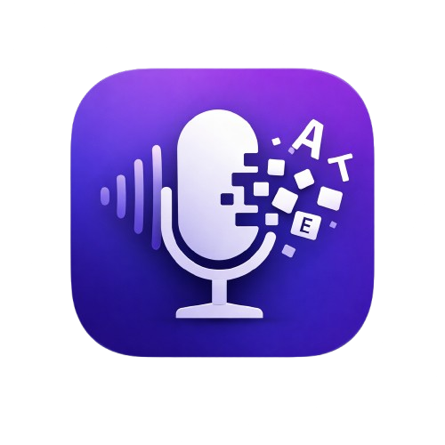

<p align="center">
  
</p>

<h1 align="center">KaraokeTyper</h1>

<p align="center">
  <strong>Offline voice dictation with push-to-talk</strong><br>
  <strong>Dictée vocale hors-ligne avec push-to-talk</strong>
</p>

<p align="center">
  <a href="#english">English</a> •
  <a href="#français">Français</a>
</p>

<p align="center">
  <a href="https://github.com/Sebdev43/KaraokeTyper/releases/latest"></a>
  
  
  
  
</p>

<p align="center">
  
  
</p>

---

# English

## Overview

**KaraokeTyper** is a privacy-first, cross-platform voice dictation application. All speech recognition happens **100% offline** using native Whisper-rs - no cloud, no telemetry, no data leaving your machine.

Press `Ctrl+Space` (or Mouse5), speak, release - your words appear instantly in any application.

## Features

| Feature | Description |
|---------|-------------|
| **Push-to-Talk** | Hold `Ctrl+Space` or Mouse5 to record, release to transcribe |
| **100% Offline** | All AI processing happens locally on your machine |
| **Cross-Platform** | Native support for Linux, Windows, and macOS |
| **Privacy-First** | Zero telemetry, zero cloud, zero data collection |
| **On-Demand Mic** | Microphone only active during recording (no system tray mic icon) |
| **Fast Transcription** | Native Whisper-rs delivers high-accuracy results in seconds |
| **Auto-Type** | Text automatically injected into focused application |
| **Multi-Language** | Support for French, English, German, Spanish, and 95+ languages |
| **Multiple Models** | Whisper Tiny/Base/Small/Medium/Large-v3 for quality/speed trade-offs |
| **Gaming Mouse Support** | Configure Mouse4, Mouse5, or any mouse button as hotkey |
| **Modern UI** | Clean dark theme with real-time status indicators |
| **System Tray** | Runs quietly in the background |

## Installation

### Download

Download the latest release for your platform:
- **Linux**: `.deb` or `.AppImage`
- **Windows**: `.msi` or `.exe`
- **macOS**: `.dmg`

👉 [Download Latest Release](https://github.com/Sebdev43/KaraokeTyper/releases/latest)

### Install on Linux

**Debian/Ubuntu (.deb):**
```bash
# Install
sudo dpkg -i karaoketyper_*_amd64.deb
sudo apt-get install -f  # Fix dependencies if needed

# Launch
karaoketyper
```

**AppImage:**
```bash
# Make executable and run
chmod +x KaraokeTyper_*_amd64.AppImage
./KaraokeTyper_*_amd64.AppImage
```

### Install on Windows

**Installer (.exe):**
1. Double-click `karaoketyper_*_x64-setup.exe`
2. Follow the installation wizard
3. Launch from Start Menu

**MSI Package:**
```powershell
# Or via command line
msiexec /i karaoketyper_*_x64_en-US.msi
```

### Install on macOS

1. Open `karaoketyper_*_aarch64.dmg` (Apple Silicon) or `karaoketyper_*_x64.dmg` (Intel)
2. Drag **KaraokeTyper** to the **Applications** folder
3. On first launch: Right-click → Open (to bypass Gatekeeper)

## Uninstallation

### Uninstall on Linux

**Debian/Ubuntu:**
```bash
sudo apt remove karaoketyper
# Or completely remove with config:
sudo apt purge karaoketyper
```

**AppImage:**
```bash
# Simply delete the file
rm KaraokeTyper_*.AppImage
# Remove user data (optional):
rm -rf ~/.config/karaoketyper
rm -rf ~/.local/share/karaoketyper
```

### Uninstall on Windows

1. Open **Settings** → **Apps** → **Installed Apps**
2. Find **KaraokeTyper** and click **Uninstall**

Or via Control Panel → Programs → Uninstall a program

**Remove user data (optional):**
```powershell
Remove-Item -Recurse "$env:APPDATA\karaoketyper"
```

### Uninstall on macOS

1. Drag **KaraokeTyper** from Applications to Trash
2. Empty Trash

**Remove user data (optional):**
```bash
rm -rf ~/Library/Application\ Support/karaoketyper
rm -rf ~/Library/Preferences/com.karaoketyper.app.plist
```

### Build from Source

#### Prerequisites

- **Node.js** 18+ and npm
- **Rust** 1.70+

```bash
# Clone the repository
git clone https://github.com/Sebdev43/KaraokeTyper.git
cd KaraokeTyper

# Install dependencies
npm install

# Run in development mode
npm run tauri dev
```

### First Launch

1. Open the **Settings** window (F10 or system tray)
2. Select your preferred Whisper model (Tiny for speed, Large-v3 for accuracy)
3. Download the model (automatic via Settings)
4. Select your microphone
5. Ready to dictate!

## Usage

### Basic Workflow

1. **Focus** any text field (browser, editor, terminal...)
2. **Hold** `Ctrl+Space` (or Mouse5) and speak clearly
3. **Release** to transcribe and auto-type

### Hotkeys

| Shortcut | Action |
|----------|--------|
| `Ctrl+Space` | Push-to-talk (hold to record) |
| `Mouse5` | Alternative push-to-talk (configurable) |
| `F10` | Open settings window |

### Status Indicators

| Color | State |
|-------|-------|
| 🟢 Green | Ready - waiting for input |
| 🔴 Red | Recording - speak now |
| 🟠 Orange | Processing - transcribing audio |

## Available Models

| Model | Size | Speed | Accuracy | Best For |
|-------|------|-------|----------|----------|
| **Whisper Tiny** | ~75MB | Fastest | Good | Quick notes, low-resource devices |
| **Whisper Base** | ~150MB | Fast | Better | Daily dictation (recommended) |
| **Whisper Small** | ~500MB | Medium | Very Good | Professional use |
| **Whisper Medium** | ~1.5GB | Slower | Excellent | High accuracy needs |
| **Whisper Large-v3** | ~3GB | Slowest | Best | Maximum accuracy |

## Building

```bash
# Development
npm run tauri dev

# Production
npm run tauri build
```

**Output formats:**
- **Linux**: AppImage, .deb
- **Windows**: .msi, .exe
- **macOS**: .dmg, .app

## Privacy & Security

- All speech recognition runs **locally** on your hardware
- **No internet connection** required for core functionality
- **No telemetry**, analytics, or tracking of any kind
- **No cloud services** - your voice data never leaves your machine
- Audio is processed in memory and **never saved** to disk
- Microphone only active when PTT key is held
- Open source - audit the code yourself

## License

This project is licensed under the **Polyform Noncommercial License 1.0.0** - see the [LICENSE](LICENSE) file for details.

**You CAN**: Use, modify, and share for personal/non-commercial purposes.
**You CANNOT**: Use commercially or sell without explicit permission.

---

# Français

## Présentation

**KaraokeTyper** est une application de dictée vocale multi-plateforme axée sur la confidentialité. Toute la reconnaissance vocale se fait **100% hors-ligne** avec Whisper-rs natif - pas de cloud, pas de télémétrie, aucune donnée ne quitte votre machine.

Appuyez sur `Ctrl+Espace` (ou Mouse5), parlez, relâchez - vos mots apparaissent instantanément dans n'importe quelle application.

## Fonctionnalités

| Fonctionnalité | Description |
|----------------|-------------|
| **Push-to-Talk** | Maintenez `Ctrl+Espace` ou Mouse5 pour enregistrer, relâchez pour transcrire |
| **100% Hors-ligne** | Tout le traitement IA se fait localement sur votre machine |
| **Multi-plateforme** | Support natif pour Linux, Windows et macOS |
| **Confidentialité** | Zéro télémétrie, zéro cloud, zéro collecte de données |
| **Micro à la demande** | Microphone actif uniquement pendant l'enregistrement (pas d'icône micro dans la barre système) |
| **Transcription rapide** | Whisper-rs natif offre des résultats de haute précision en quelques secondes |
| **Frappe automatique** | Le texte est automatiquement injecté dans l'application active |
| **Multi-langue** | Support du français, anglais, allemand, espagnol et 95+ langues |
| **Plusieurs modèles** | Whisper Tiny/Base/Small/Medium/Large-v3 pour différents compromis qualité/vitesse |
| **Support souris gaming** | Configurez Mouse4, Mouse5 ou n'importe quel bouton comme raccourci |
| **Interface moderne** | Thème sombre avec indicateurs de statut en temps réel |
| **Barre système** | Fonctionne discrètement en arrière-plan |

## Installation

### Téléchargement

Téléchargez la dernière version pour votre plateforme :
- **Linux** : `.deb` ou `.AppImage`
- **Windows** : `.msi` ou `.exe`
- **macOS** : `.dmg`

👉 [Télécharger la dernière version](https://github.com/Sebdev43/KaraokeTyper/releases/latest)

### Installer sur Linux

**Debian/Ubuntu (.deb) :**
```bash
# Installer
sudo dpkg -i karaoketyper_*_amd64.deb
sudo apt-get install -f  # Corriger les dépendances si nécessaire

# Lancer
karaoketyper
```

**AppImage :**
```bash
# Rendre exécutable et lancer
chmod +x KaraokeTyper_*_amd64.AppImage
./KaraokeTyper_*_amd64.AppImage
```

### Installer sur Windows

**Installateur (.exe) :**
1. Double-cliquez sur `karaoketyper_*_x64-setup.exe`
2. Suivez l'assistant d'installation
3. Lancez depuis le menu Démarrer

**Package MSI :**
```powershell
# Ou via ligne de commande
msiexec /i karaoketyper_*_x64_en-US.msi
```

### Installer sur macOS

1. Ouvrez `karaoketyper_*_aarch64.dmg` (Apple Silicon) ou `karaoketyper_*_x64.dmg` (Intel)
2. Glissez **KaraokeTyper** vers le dossier **Applications**
3. Au premier lancement : Clic droit → Ouvrir (pour contourner Gatekeeper)

## Désinstallation

### Désinstaller sur Linux

**Debian/Ubuntu :**
```bash
sudo apt remove karaoketyper
# Ou supprimer complètement avec la config :
sudo apt purge karaoketyper
```

**AppImage :**
```bash
# Supprimez simplement le fichier
rm KaraokeTyper_*.AppImage
# Supprimer les données utilisateur (optionnel) :
rm -rf ~/.config/karaoketyper
rm -rf ~/.local/share/karaoketyper
```

### Désinstaller sur Windows

1. Ouvrez **Paramètres** → **Applications** → **Applications installées**
2. Trouvez **KaraokeTyper** et cliquez sur **Désinstaller**

Ou via Panneau de configuration → Programmes → Désinstaller un programme

**Supprimer les données utilisateur (optionnel) :**
```powershell
Remove-Item -Recurse "$env:APPDATA\karaoketyper"
```

### Désinstaller sur macOS

1. Glissez **KaraokeTyper** depuis Applications vers la Corbeille
2. Videz la Corbeille

**Supprimer les données utilisateur (optionnel) :**
```bash
rm -rf ~/Library/Application\ Support/karaoketyper
rm -rf ~/Library/Preferences/com.karaoketyper.app.plist
```

### Compiler depuis les sources

#### Prérequis

- **Node.js** 18+ et npm
- **Rust** 1.70+

```bash
# Cloner le dépôt
git clone https://github.com/Sebdev43/KaraokeTyper.git
cd KaraokeTyper

# Installer les dépendances
npm install

# Lancer en mode développement
npm run tauri dev
```

### Premier lancement

1. Ouvrez la fenêtre **Paramètres** (F10 ou barre système)
2. Sélectionnez votre modèle Whisper préféré (Tiny pour la vitesse, Large-v3 pour la précision)
3. Téléchargez le modèle (automatique via Paramètres)
4. Sélectionnez votre microphone
5. Prêt à dicter !

## Utilisation

### Workflow de base

1. **Focalisez** n'importe quel champ texte (navigateur, éditeur, terminal...)
2. **Maintenez** `Ctrl+Espace` (ou Mouse5) et parlez clairement
3. **Relâchez** pour transcrire et taper automatiquement

### Raccourcis clavier

| Raccourci | Action |
|-----------|--------|
| `Ctrl+Espace` | Push-to-talk (maintenir pour enregistrer) |
| `Mouse5` | Push-to-talk alternatif (configurable) |
| `F10` | Ouvrir les paramètres |

### Indicateurs de statut

| Couleur | État |
|---------|------|
| 🟢 Vert | Prêt - en attente |
| 🔴 Rouge | Enregistrement - parlez maintenant |
| 🟠 Orange | Traitement - transcription en cours |

## Modèles disponibles

| Modèle | Taille | Vitesse | Précision | Idéal pour |
|--------|--------|---------|-----------|------------|
| **Whisper Tiny** | ~75Mo | Plus rapide | Bonne | Notes rapides, appareils peu puissants |
| **Whisper Base** | ~150Mo | Rapide | Meilleure | Dictée quotidienne (recommandé) |
| **Whisper Small** | ~500Mo | Moyenne | Très bonne | Usage professionnel |
| **Whisper Medium** | ~1.5Go | Lente | Excellente | Haute précision |
| **Whisper Large-v3** | ~3Go | Plus lente | Meilleure | Précision maximale |

## Compilation

```bash
# Développement
npm run tauri dev

# Production
npm run tauri build
```

**Formats de sortie :**
- **Linux** : AppImage, .deb
- **Windows** : .msi, .exe
- **macOS** : .dmg, .app

## Confidentialité et sécurité

- Toute la reconnaissance vocale s'exécute **localement** sur votre machine
- **Aucune connexion internet** requise pour les fonctionnalités principales
- **Aucune télémétrie**, analytique ou suivi
- **Aucun service cloud** - vos données vocales ne quittent jamais votre machine
- L'audio est traité en mémoire et **jamais sauvegardé** sur le disque
- Microphone actif uniquement quand la touche PTT est maintenue
- Open source - auditez le code vous-même

## Licence

Ce projet est sous licence **Polyform Noncommercial License 1.0.0** - voir le fichier [LICENSE](LICENSE) pour plus de détails.

**Vous POUVEZ** : Utiliser, modifier et partager pour usage personnel/non-commercial.
**Vous NE POUVEZ PAS** : Utiliser commercialement ou vendre sans autorisation explicite.

---

## Architecture

```
KaraokeTyper/
├── src/                    # Frontend React/TypeScript
│   ├── components/         # UI components (shadcn/ui)
│   ├── stores/             # State management (Zustand)
│   └── bindings.ts         # Tauri TypeScript bindings
├── src-tauri/              # Backend Rust
│   ├── src/
│   │   ├── lib.rs          # Tauri commands & setup
│   │   ├── audio.rs            # Audio capture (CPAL cross-platform)
│   │   ├── stt_whisper.rs  # Native Whisper-rs STT engine
│   │   ├── model_downloader.rs  # Model download manager
│   │   ├── output.rs       # Text injection (enigo/uinput)
│   │   ├── evdev_listener.rs    # Linux input events
│   │   └── keyboard_listener.rs # Push-to-talk handler
│   └── Cargo.toml
└── README.md
```

## Tech Stack

| Layer | Technology |
|-------|------------|
| **Frontend** | React 18, TypeScript, Tailwind CSS, shadcn/ui, Zustand |
| **Backend** | Rust, Tauri 2.0 |
| **STT Engine** | Whisper-rs (native Rust bindings to whisper.cpp) |
| **Audio** | CPAL (ALSA on Linux, WASAPI on Windows, CoreAudio on macOS) |
| **Keyboard** | rdev (Windows/macOS), evdev (Linux) |
| **Text Output** | enigo, arboard, uinput |

---

## Contributing / Contribuer

We welcome contributions! / Les contributions sont les bienvenues !

1. **Fork** the repository / Forkez le dépôt
2. Create a **feature branch** from `dev` / Créez une branche depuis `dev`
3. Make your changes / Faites vos modifications
4. Run tests / Lancez les tests :
   ```bash
   cd src-tauri && cargo clippy && cargo test
   npx biome check --write src/
   ```
5. Submit a **Pull Request** to `dev` / Soumettez une PR vers `dev`

---

## Credits / Crédits

- [whisper-rs](https://github.com/tazz4843/whisper-rs) - Rust bindings for whisper.cpp
- [whisper.cpp](https://github.com/ggerganov/whisper.cpp) - High-performance C++ inference
- [OpenAI Whisper](https://github.com/openai/whisper) - Speech recognition models
- [Tauri](https://tauri.app) - Cross-platform app framework
- [shadcn/ui](https://ui.shadcn.com) - Beautiful UI components
- [rdev](https://github.com/Narsil/rdev) - Cross-platform input events
- [enigo](https://github.com/enigo-rs/enigo) - Cross-platform input simulation

---

<p align="center">
  <strong>Built with care for privacy-conscious users</strong><br>
  <strong>Conçu avec soin pour les utilisateurs soucieux de leur vie privée</strong>
</p>

<p align="center">
  <a href="https://github.com/Sebdev43/KaraokeTyper/issues">Report Bug / Signaler un bug</a> •
  <a href="https://github.com/Sebdev43/KaraokeTyper/issues">Request Feature / Demander une fonctionnalité</a>
</p>
